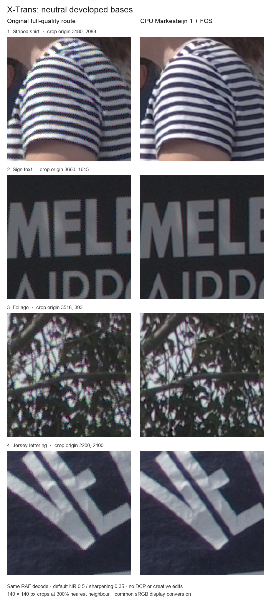

# RapidRAW · FujiFilm Edition

**Open a RAF. Find your colours. Make it yours.**

Camera profiles, creative colour tools and a growing Android workflow for Fujifilm photographers.

[**Experimental Android v1.6.27**](https://github.com/harrytuckerr/RapidRAW-FF-Edition/releases/download/v1.6.27/RapidRAW-Fujifilm-Edition-1.6.27-android-arm64-debug.apk) · [**Releases**](https://github.com/harrytuckerr/RapidRAW-FF-Edition/releases) · [**Start editing**](#start-editing-on-android) · [**Camera profiles**](#bring-your-own-camera-profiles) · [**Current status**](#where-things-stand) · [**Build & contribute**](#build--contribute)

 

_Upstream RapidRAW desktop screenshot, credited to [Timon Käch / RapidRAW](https://github.com/CyberTimon/RapidRAW). It does not show the current Android/Fold build._

## A few ways to make a photo yours

Tools in this edition, subject to image, asset and calibration support. Check the release notes for the APK you install:

|     | Tool                       | What you can do                                                                                                  |
| :-: | -------------------------- | ---------------------------------------------------------------------------------------------------------------- |
| 🌿  | **Fujifilm RAF / X-Trans** | Develop supported X-Trans RAWs with the CPU Markesteijn path and false-colour filtering.                         |
| 🎨  | **Point Colour**           | Pick one colour range, then adjust its Hue, Saturation and Luminance.                                            |
| 📐  | **Auto straighten**        | Estimate a small rotation from the completed preview, with normal undo. Ambiguous scenes can return no change.   |
| ✨  | **Denoise**                | Compare a noise-reduction preview before saving the result.                                                      |
| 🔎  | **Lens correction**        | Try automatic lens matching, or choose a profile where calibration is available.                                 |
| 📷  | **Camera-aware defaults**  | Start eligible fresh RAWs with a matching Cobalt Modular base while respecting saved and manual profile choices. |

Profiles set the starting colour. Your exposure, curves, masks, presets and creative adjustments build on it.

## Fuji X-Trans: before and after

Fine stripes, lettering and foliage can reveal false colour in the original X-Trans interpolation. FujiFilm Edition uses CPU Markesteijn one-pass demosaicing with false-colour suppression for a cleaner starting point.

_Fujifilm X-Pro2 RAW; four 140 × 140 pixel crops enlarged to 300%. Both sides use the app’s default RAW noise reduction and sharpening, with no DCP or creative edits. These are developed RAW bases shown with the same neutral sRGB display conversion, rather than final edited exports._

The comparison uses RapidRAW’s own code on both sides. Markesteijn algorithm attribution and licensing are listed [below](#built-on-rapidraw).

## Start editing on Android

1. **Get the experimental build.** [Download the Android ARM64 APK for v1.6.27](https://github.com/harrytuckerr/RapidRAW-FF-Edition/releases/download/v1.6.27/RapidRAW-Fujifilm-Edition-1.6.27-android-arm64-debug.apk). This is a **debug-signed experimental community build**, published as a prerelease; read its [notes and limitations](https://github.com/harrytuckerr/RapidRAW-FF-Edition/releases/tag/v1.6.27) before installing. [Corresponding source](https://github.com/harrytuckerr/RapidRAW-FF-Edition/releases/download/v1.6.27/RapidRAW-Fujifilm-Edition-1.6.27-corresponding-source.tar.gz) and checksums accompany the release.
2. **Install it.** Open the APK and allow installation from that app if Android asks. Use the offered update for an existing installation.
3. **Open a photo.** Choose an image or folder through Android’s file picker. Wait for the full preview before sampling the photo.
4. **Make your edit.** Explore the colour, crop and lens tools. Undo and redo let you revisit your choices.
5. **Export to share.** Edit settings autosave as `.rrdata` data; your original RAW stays untouched. Export creates the finished image.

## Bring your own camera profiles

In the profile browser, use **Import** to add your camera’s `.dcp` base and optional `.xmp` Looks through Android’s file picker. Choose a base, then a compatible Look. Unsupported pairings stay disabled.

**Cobalt profiles and Looks are proprietary and are not included.** Import files you lawfully own; a Look needs the correct base for your camera. Profiles are distinct from presets and creative LUTs.

Eligible fresh, unsaved RAWs can start with a unique matching **Cobalt Modular** base when a supported compatible Look is installed. Only the base is selected. Saved edits and explicit **No Profile** choices take priority.

See the [profile guide](docs/profiles.md) for pairing and controls; its platform-status notes are historical.

## Where things stand

**Status: 21 October 2026 · experimental Android source 1.6.27**

This is an actively developed fork. Use the [1.6.27 checkpoint notes](docs/releases/1.6.27.md) for the current source changes and validation limits, and [published release notes](https://github.com/harrytuckerr/RapidRAW-FF-Edition/releases) for downloadable builds.

- **1.6.27 is the latest experimental Android ARM64 source/build checkpoint.** Its debug-signed APK passed scoped package checks and an in-place Samsung Fold install was verified. Phone performance on 1.6.27 is **not yet exercised**. It is an experimental prerelease, not a stability or all-device acceptance claim.
- **Editing and zoom:** the user reported a marked improvement on 1.6.25; five captured preview-cache hits support reuse on that observed path. This is not a controlled gesture-to-paint benchmark or a promise for every photo.
- **Opening:** 1.6.26 adds compiled-program handoff from the opening preview to the editor. Device logs showed program reuse, but lack route IDs to attribute it to that specific handoff. Initial opening was still reported at about 10 seconds. Version 1.6.27 removes an unnecessary owned RGB copy for selected-profile opening without AI patches; its focused CPU and real-GPU cases passed. It does not remove a RAW development pass, and a phone speed improvement is not established.
- **Subject masks:** one Subject operation completed in 11.78 seconds on 1.6.24. Earlier low-memory exits and later masked-edit delays remain relevant; that single completion is not general crash or memory acceptance. Requested-model-family loading, borrowed reference pixels, explicit unfinished-mask state and fresh-mask preview reuse are included.
- **Still open:** some saved edits can fail with `DevelopmentFailed`; a legacy missing mask payload is one unresolved recovery case, not a reason to reset all edits. Subject-mask memory/crash risk, initial RAW/DCP opening and profile switching latency, and colour-dropper workflow limitations remain under investigation. Keep your RAWs, profiles and `.rrdata` files backed up; recovery must preserve them.
- The source includes upstream RapidRAW changes through `6e2631ad`, alongside the Fuji RAW path, profiles, Point Colour and guarded preview editing. Each release records its own build, test and device checks.

Recent device validation is **Android-focused**. Desktop features are inherited from upstream; this fork has not received equivalent current desktop validation.

Auto straighten is a helpful starting point, not a guarantee of a level horizon. You can keep adjusting manually or undo the result; ambiguous scenes may produce no change.

**GPU demosaicing/GPU1 is not accepted.** Capture One performance/quality parity and Adobe Camera Raw parity are unverified; matching their rendering or speed is not promised.

On the later list: [give the white-balance template dropdown the same styling as the editor](https://github.com/harrytuckerr/RapidRAW-FF-Edition/issues/18).

Found something unexpected? [Open an issue](https://github.com/harrytuckerr/RapidRAW-FF-Edition/issues) with the build version, camera, device and steps that reproduce it.

## Build & contribute

- [Build instructions](docs/BUILD.md) — desktop and isolated Android workflows.
- [Known CI baseline](https://github.com/harrytuckerr/RapidRAW-FF-Edition/issues/1) — inherited checks remain unresolved; release notes record the scoped local validation.
- [Profile pipeline](docs/dcp-pipeline.md) — rendering design and known limitations.
- [Documentation](docs/) — background guides; check dated status notes against this README.
- [Notices and attribution](NOTICE.md) · [Source license](LICENSE).

## Built on RapidRAW

Built on **[RapidRAW](https://github.com/CyberTimon/RapidRAW) by [Timon Käch](https://github.com/CyberTimon)** and its contributors. Thank you for making this foundation available.

The application remains **AGPL-3.0**. X-Trans code retains its [LGPL-2.1-only license](src-tauri/resources/licenses/LGPL-2.1.txt) and attribution to Frank Markesteijn’s method in LibRaw. See [NOTICE.md](NOTICE.md) for attribution and profile-use terms.

**FujiFilm Edition is an independent project, not an official Fujifilm product.**
